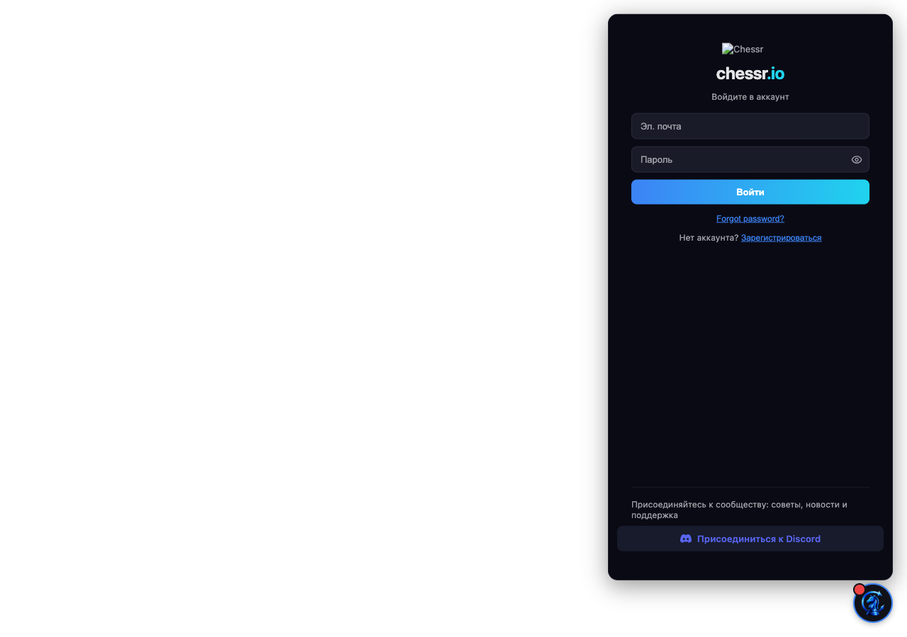
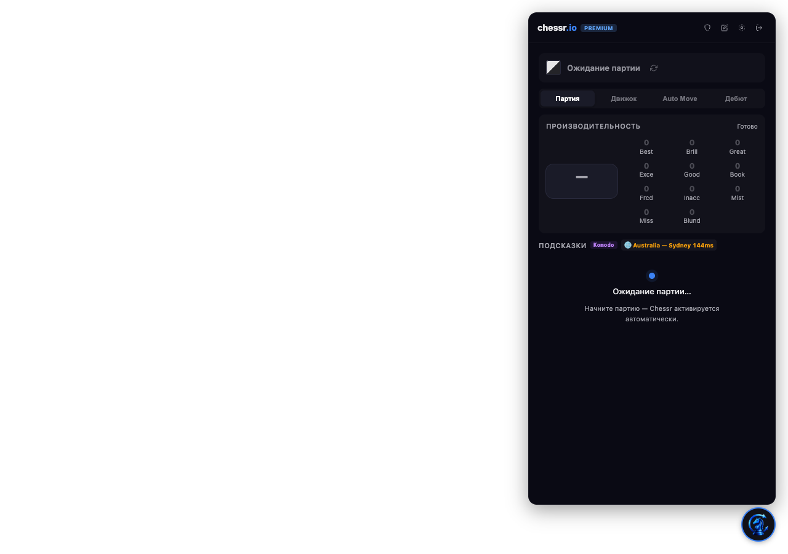

# Verification

Two layers: a static checklist that runs offline on every commit, and a runtime smoke test
that loads the extension in a real browser. The static layer is `scripts/verify.py`; this
file documents the runtime layer so it can be repeated when a new version is processed.

## 1. Static

```bash
python3 scripts/verify.py            # every check
python3 scripts/verify.py --only anchors,patches,signatures
```

What it proves for 3.7.2:

- every JS file in the build parses (`node --check`, sloppy mode);
- every JSON document is valid;
- every relative link and heading anchor in the tracked Markdown resolves;
- each `unlock-manifest.json` anchor occurs the declared number of times in the baseline;
- the patch series applies to a pristine copy of the baseline and reproduces `build.json`;
- schema versions agree with `repo-meta.json`, and the signature matches its baseline;
- the folder name, both manifests, `build.json` and the changelog agree on the version.

`check_js_syntax` runs sloppy-mode checks. The two large bundles were additionally parsed as
ES modules during the 3.7.2 restore, because `stream.html` loads its chunk with
`type="module"` and a strict-mode-only failure would not show up in `node --check`.

## 2. Runtime smoke test

Chrome 137+ removed `--load-extension` from the branded build, so the test uses a Chromium
snapshot instead of the installed Chrome:

```bash
# once: fetch a Chromium build (~200 MB, not committed)
npx @puppeteer/browsers install chromium@latest --path work/chromium

# the test page must be served over TLS on a chess.com hostname, because chess.com is
# HSTS-preloaded: map the host and ignore the self-signed certificate
openssl req -x509 -newkey rsa:2048 -keyout work/key.pem -out work/cert.pem -days 2 -nodes \
  -subj "/CN=www.chess.com"
python3 work/tls_server.py &        # http.server on 127.0.0.1:8443 with that certificate

node work/probe.mjs <build-dir> <label>
```

`probe.mjs` launches the browser with
`--load-extension=<build-dir> --disable-extensions-except=<build-dir>
--host-resolver-rules="MAP www.chess.com 127.0.0.1:8443" --ignore-certificate-errors`,
opens `https://www.chess.com/site/test.html`, waits six seconds, reads the shadow root,
clicks the floating button, reads the panel again and writes `work/shot-<label>.png`.

### Observed results (2026-11, Chromium 1732437)

| | baseline | unlocked build |
|---|---|---|
| shadow root rendered | yes (87 819 bytes) | yes (87 746 bytes) |
| floating button | present | present |
| panel after click | sign-in form | analysis panel |
| auth form / email input | present / 1 | absent / 0 |
| panel text | “chessr .io”, “Войдите в аккаунт”, “Войти”, “Забыли пароль?”, “Зарегистрироваться” | “.io”, “Premium”, “Ожидание партии”, “Партия”, “Движок”, “Auto Move”, “Дебют”, “Производительность” |
| console | 404 for `/icons/x9110e26d-logo.png` (`ERR_FILE_NOT_FOUND`) | 404 for the same asset, plus two 401s from authenticated-looking requests made with the placeholder session |



_Stock build: sign-in form, broken namespaced logo._



_Unlocked build: panel opens directly, badged Premium, no auth form._

Interpretation: the restored bundle boots, React mounts, the overlay renders and the unlock
removes the sign-in gate. The 401s are the expected consequence of the fake session and are
the runtime evidence for the limitation described in the README — the panel works, the
server-authorised analysis does not.

## 3. Local engine harness (3.7.2 graft)

The transplanted engines are driven directly from the same instrumented build: a temporary
`document.addEventListener("chessr-local-test")` hook constructs each class from
`_0x4c1d1e`, calls `init()` and `search()` on the start position (depth 14, MultiPV 3) and
writes the rows to `document.documentElement.dataset.localTest`. Observed:

| Engine | Init | Search | Rows (MultiPV, move, cp, depth) |
|---|---|---|---|
| Komodo | 200 ms | 164 ms | 1 e2e4 +0.54 d14 · 2 d2d4 +0.28 d14 · 3 g1f3 +0.28 d14 |
| Stockfish | 228 ms | 143 ms | 1 e2e4 +0.42 d14 · 2 e2e3 +0.20 d14 · 3 g1f3 +0.19 d14 |
| Maia 3 | 398 ms | 84 ms | 1 e2e4 · 2 d2d4 · 3 c2c4 (model probabilities, position eval +0.14) |

The factory wraps `init()` in a 20 s timeout, so a local engine that hangs falls through to
the server path instead of freezing the panel.

### Rodent IV: why it is not in the build

The 3.4.0 Rodent class was transplanted and exercised. The engine is an Emscripten build
whose UCI input is a `FS.init` device callback that returns `null` when its buffer is empty.
Measured behaviour in the harness:

1. The engine performs its **first stdin read before any command can arrive**, so the read
   returns `null` on a fresh worker;
2. `null` from the device callback is a sticky EOF for C stdio — after it, `uci` is answered
   (it was already buffered) but `setoption`/`isready` never are, and a second `uci` is
   ignored;
3. suspending instead of returning `null` via `Asyncify.handleSleep` unwinds and then traps
   at `unreachable`, because the build's async imports are not instrumented for it;
4. pre-seeding the worker with the whole UCI script plus newline padding produces a
   `bestmove` once (2.7 s at depth 6) but is unstable — larger pads or repeated runs abort
   at depth 4 with `memory access out of bounds`, because the search loop polls stdin and
   either exhausts the pad (EOF) or overflows on a continuous filler.

The same failure was reproduced with an independent driver that takes the other obvious
route — batching `uci` and `isready` before awaiting either reply, then sending
`position`/`go` together — and with the byte-identical `rodent.js`/`.wasm`/`.data` (md5
`a8b82ebafbd479c0e3e4b63220f117c4`): handshake succeeds, every option is enumerated, and
the first search times out. batching fixes the handshake, not the search.

A reliable fix needs the engine recompiled with an async stdin loop (for example
`emscripten_sleep` while the command queue is empty), which is a different artifact from the
shipped wasm. Until then Rodent, like Leela, is server-only, and the factory falls back to
the server when it is selected.

### What it does not prove

- The site adapters: the test page has no chess.com board API, so `pageContext.js` finds no
  game. Board reading is verified only by code inspection and by the message vocabulary in
  `knowledge-base/messaging.md`.
- Analysis: the server is not contacted with a real session, by policy.
- Stream Mode: `stream.html` was parsed as a module but not rendered, because the page
  needs the extension origin and the auth store — loading it would exercise the same code
  path as the panel already covered.
